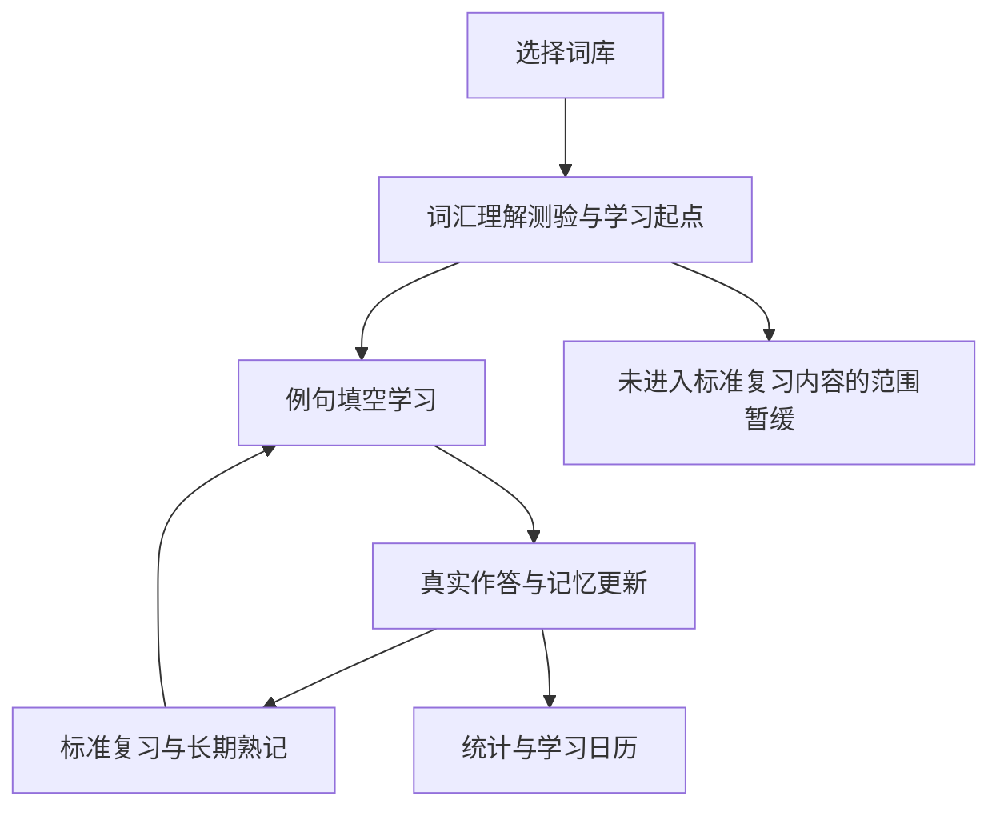

# 项目构想与产品原则

本项目面向希望长期积累英语词汇的学习者，主要使用场景是安装在 iPhone 主屏幕上的 Web App。用户通过英文例句中的填空回忆当前含义对应的单词，系统依据真实作答安排后续复习。产品名称为“语境学词 · Context”。

## 学习闭环

选择词库 → 可选词汇理解测验 → 例句填空 → 记录独立或辅助作答 → 更新记忆状态 → 到期复习 → 通过统计与日历查看积累。

产品同时解决三个问题。词库决定学什么，水平检测帮助选择新内容的难度与初始排除范围，记忆模型决定已经学过的内容何时复习。三者分别承担自己的职责。

## 已确认的产品原则

- 学习围绕具体含义和学习单元展开。同一词头的不同含义具有各自的学习价值，词形关系帮助归并进度。
- 题目使用真实例句和对应解释，用户在句中输入答案。每个账号和学习单元固定例句，保证跨设备及复习体验连续。
- 独立作答、听提示后作答和看答案后纠正分别处理。辅助完成不能冒充独立掌握。
- 标准复习和长期熟记由记忆模型管理。两次独立答对只贡献记忆证据，额外的个人暂缓路径已取消。
- 水平暂缓仅用于尚未进入标准复习的内容。已经学习的单元继续按原复习计划安排。
- 用户可以跳过基础 800 词，也可以主动“不再学习”某个词。明确的排除选择单独保存。
- 页面优先复用导航、卡片、按钮和输入组件。操作已表达的含义无需再添加重复小字。
- 用户账号、历史、复习进度和内容曝光相互隔离，内容修订与发布要保留已有学习数据。

## 当前交付范围

已实现多用户认证、通行密钥、词库选择、例句学习、动态复习、长期熟记、词汇理解测验、有限范围暂缓、词典与更多词义、错误反馈、管理员审核、学习日历、主题、离线内容浏览和学习提醒。

现行服务器使用 Rust API、SQLite 和 Nginx，前端采用 React 与 TypeScript。Python 主要用于内容制作、校验、兼容性参考与维护工具。

## 后续验证方向

继续通过真实用户作答验证题目难度、测验分级稳定性和长期复习效果。测验题量按五六分钟设计，实际完成时间需要真人验证。手机浏览器模拟与真实 iPhone Safari、主屏幕 PWA 的设备验收分别记录。

## 文档使用

产品边界以本篇和模块文档为准，具体路由与代码入口从[总路由表](../项目文档路由表.md)查阅。涉及词汇检测的详细参数继续维护在[词汇测验说明](../vocabulary-assessment.md)。历史迁移方案和某次发布证据用于追溯当时行为。
