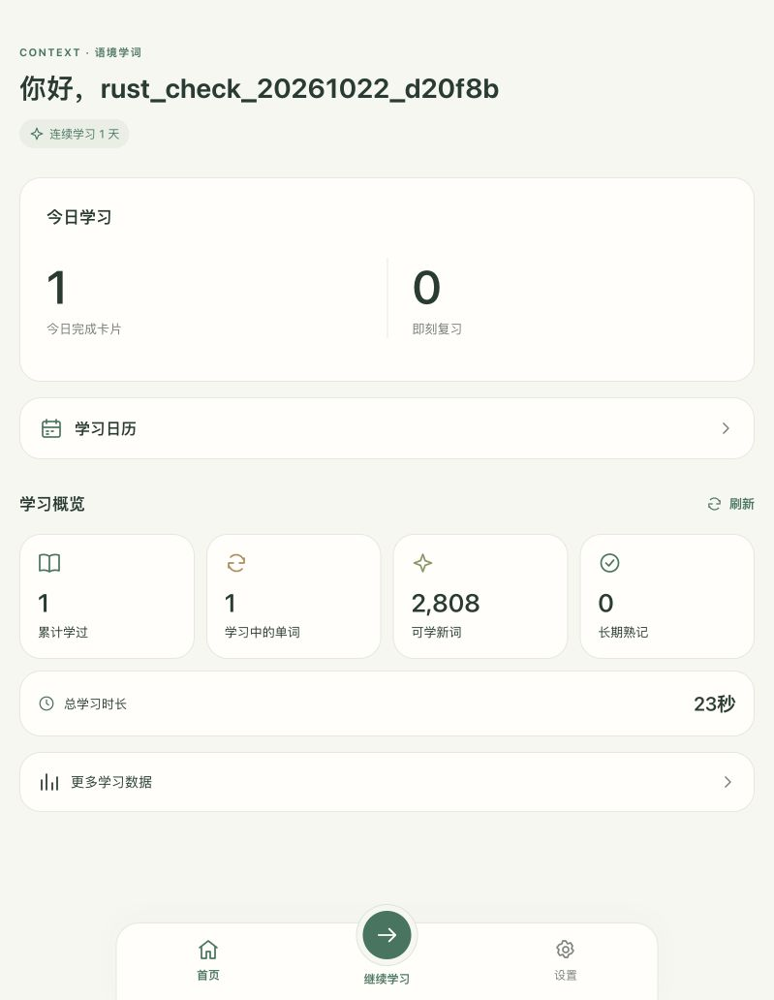

# Rust 迁移验证与性能对比

本报告使用同一台生产服务器上的隔离 SQLite 快照，对照原 Python 后端与 Rust release。验证工具不会把真实数据库、账户凭据或目录正文下载到本机。生产已于 2026-10-22 12:34（Asia/Shanghai）切换至 Rust，公开版本为 `26.10.22.94`。

## 测量条件

- 比较基线是 Rust 切换前已经做过流式目录和内存优化的 Python 版本，不是此前发生 OOM 的未优化版本。
- 日期：2026-10-22；Ubuntu x86_64，glibc 2.35，约 914 MiB 内存与 1 GiB Swap。
- Python：服务器现有 Python 3.10.12 与原生产依赖；Rust：1.99.1、Cargo.lock 固定依赖、release/LTO。
- 数据：v22 数据库快照；公共词头 13,424、词义 65,464、例句 90,178、学习单元 87,158、课程单元映射 157,592。
- 原生 HTTP 服务：1 写连接、2 读连接、16 个并发请求槽、每连接约 2 MiB SQLite 页缓存。测试期间使用各自独立的数据库，不让新旧后端同时写生产主库。
- 接口比较冻结 UTC 时钟，使用同一账号状态的两份快照和临时测试会话。随机 attempt_id 按对应关系替换，其余响应按结构、值和浮点容差比较。
- 压测客户端运行在服务器本机，测量环回 HTTP，不包含公网、TLS 或浏览器渲染延迟。不同后端顺序测试，避免两套负载同时争抢 CPU。
- 两个 HTTP 比较进程都直接打开已准备好的快照，Python 参考关闭 ASGI lifespan，不在测量中重新同步大型内容。报告没有把这一启动差异当作全应用启动提速。
- 表中 RSS 为服务进程自启动以来的 `/proc/<pid>/status` VmHWM，各并发档顺序累计；CPU 为该档前后增量。cgroup 内存另行记录，不与 RSS 混算。

## 目录冷构建

每种实现 5 次，输出完整字节与 SHA-256 一致：35,190,486 字节，`ef7175b4741924efa1d182e6453c487b2f401cf1e5682d4f74005478d75d10e7`。测量整个一次性 CLI 进程，峰值 RSS 包含进程加载开销。

| 指标 | Python | Rust | 变化 |
|---|---:|---:|---:|
| 耗时中位数 | 1.52 秒 | 0.84 秒 | 减少 44.7%，约 1.81 倍速度 |
| 最小–最大耗时 | 1.50–1.88 秒 | 0.80–1.03 秒 | 原始样本保留在服务器 |
| 峰值 RSS 中位数 | 24,576 KiB | 13,568 KiB | 减少 44.8% |

此处是目录冷构建的结果，不能解读为整个应用快了 1.81 倍。样本仅 5 次，不把尾部插值包装成可靠的 P95。

## 查询优化

真实词库暴露了小样本测试无法体现的查询成本：设置接口调用课程进度统计，原生课程查询在最初的 2 秒资源预算内无法稳定完成。修改后，设置只查询偏好；课程统计先物化可学习单元，再汇总课程词头。原始与候选查询完整结果一致。隔离实测中原统计约 1.90 秒，预聚合后的原生查询约 0.30 秒。

该收益同时来自查询结构调整与运行时变化，不能归因于语言本身。最终生产读取预算定为 5 秒：统计接口在历史较多账号上热运行约 1.8 秒，需要覆盖首次读取和磁盘波动。固定连接数、16 个请求槽与 SQL 中断机制继续限制资源。实际 HTTP 压测会单独给出；不会用 SQL 单项耗时代替接口延迟。

## 功能验证

- 流式指纹与 Python 规范化哈希一致；内容暂存包、完整校验、乐观锁、事务回滚、重复导入为空操作。
- 旧密码/会话/COSE 通行密钥兼容；软件认证器真实签名、来源约束、计数器、挑战一次消费与重放拒绝。
- 出题、答题、提示、曝光、FSRS、成熟度、个体校准、统计与日历进行响应和数据库状态对照。
- 管理权限、反馈审核、内容覆盖、审核导入预览/备份/回执及中途失败回滚。
- 推送订阅旧键格式与来源限制、领取/成功/失败/过期状态、每日去重、三次重试与结果不确定时不重发。
- 公共发布种子经表白名单导出，账号、会话、密钥、订阅、答题与学习状态均为空；保留公共词形、课程和学习单元映射。

## HTTP 压测与生产检查

同机环回 HTTP 混合负载为设置、课程、统计、日历和词典，每个并发档各 60 次请求。统计 P50/P95 使用排序后的观测值，不包含公网和浏览器渲染。

| 并发 | 实现 | 成功/总请求 | P50 | P95 | 成功吞吐 | 峰值 RSS |
|---:|---|---:|---:|---:|---:|---:|
| 1 | Python | 60/60 | 527.5 ms | 922.1 ms | 2.31 次/秒 | 73.2 MiB |
| 1 | Rust | 60/60 | 9.0 ms | 853.0 ms | 4.12 次/秒 | 35.4 MiB |
| 5 | Python | 60/60 | 2449.9 ms | 5030.3 ms | 2.43 次/秒 | 98.8 MiB |
| 5 | Rust | 60/60 | 1084.9 ms | 3792.7 ms | 3.13 次/秒 | 49.6 MiB |

并发 1 的成功吞吐提高约 78%，并发 5 提高约 29%；并发 5 的 P95 降低约 24.6%，峰值 RSS 降低约 49.8%。不同接口开销差异很大，P50 的变化不能用于推断每个页面都快相同倍数。

并发 20 的无重试过载测试中，Python 为 60/60 成功，P95 20.93 秒、峰值 RSS 180.4 MiB；Rust 为 17/60 成功，43 次返回 503，成功请求 P95 4.36 秒、峰值 RSS 49.6 MiB。这代表资源准入保护，并不代表相同工作量已经完成；不据此计算吞吐提升或声称 20 并发零错误。补充测试按 503 的 Retry-After 语义等待至少 1 秒，最多重试 10 次，包含等待时间，结果如下：

| 并发 20，包含重试等待 | Python | Rust |
|---|---:|---:|
| 最终完成 | 60/60 | 60/60 |
| 额外重试次数 | 0 | 60 |
| 总耗时 | 23.58 秒 | 25.04 秒 |
| 完成吞吐 | 2.54 次/秒 | 2.40 次/秒 |
| P50 / P95 | 8.68 / 19.57 秒 | 3.45 / 15.24 秒 |
| 峰值 RSS | 184.1 MiB | 49.5 MiB |

这档负载下 Rust 峰值 RSS 降低约 73.1%、P95 降低约 22.1%，但完成吞吐下降约 5.8%，CPU 总量也没有明显下降。说明本轮对高并发的主要收益是资源上限与尾部等待控制；计算密集的统计查询仍限制吞吐。客户端不重试时会看到 503，不能声称 20 并发无错误。

目录冷 HTTP（包含构建和读取响应）为 Python 3063.5 ms、Rust 2170.8 ms，各一次，仅作端到端检查，不替代前面的五次 CLI 构建分布。

真实数据的 15 个响应/学习动作对照全部通过，目录完整字节一致。同库 Rust → Python → Rust 隔离回退演练已通过，响应与学习记录数量一致；旧后端解析了 654 张 FSRS 卡片。干净环境验收通过：chroot 仅有两个 Rust 产物、静态前端、公共内容种子、glibc 与系统证书，没有 Python/Node/Cargo；完成 29 个账号、学习、词典、设置与管理操作，并使用原生 CLI 建立一致性备份。测试驱动在 chroot 外运行。浏览器与上线观察结果如下。

原始聚合记录见 [HTTP](rust-evidence/2026-10-22/http.json)、[重试负载](rust-evidence/2026-10-22/retry.json)、[目录](rust-evidence/2026-10-22/catalogue.json)、[回退](rust-evidence/2026-10-22/rollback.json) 和 [干净环境接口验收](rust-evidence/2026-10-22/clean-runtime.json)。

## 生产切换与浏览器验收

代码与部署脚本已提交、推送 main；生产 release 记录源码提交 `9264eba9df39988c9c9b6e9e06015fb3e72df20c`，功能主提交为 `352ff0e`。实际进程为 `/opt/englishlearning/releases/rust-26.10.22.94/bin/english-server`，Nginx 直接提供静态前端，生产 API 与提醒单元均调用 Rust 二进制。

首次切换在 Nginx 重载后的公开版本检查遇到短暂 404，保护脚本自动恢复原 release、systemd 与 Nginx，没有覆盖数据库。补上等待公开端口返回准确发布版本的检查后，第二次切换成功。这次实际自动恢复与此前同库隔离回退共同验证了恢复路径。

12:46 的运行观察：

- 域名、IPv4 和 IPv6 的 HTTPS 健康检查均为 200，证书验证通过；公开版本 `26.10.22.94`。
- 服务 active，NRestarts=0，6 个线程；观察到 RSS 81,736 KiB（约 79.8 MiB），cgroup MemoryCurrent 147,337,216 字节（约 140.5 MiB，包含文件缓存），低于配置的 192 MiB MemoryHigh / 256 MiB MemoryMax。这个值包含实际页面、目录和账号使用，不能替代前面的隔离压测数据。
- 当前启动周期未发现 OOM 记录；Rust 服务切换后的 warning/error 日志为空。原生 `englishctl` 提醒已连续按分钟执行，Result=success。当时不在 20:00 提醒窗口，没有向真实设备额外发送测试通知。
- SQLite quick_check=ok、foreign_key_check=0；2 个真实账号、1 个通行密钥、1848 条答题历史、654 张 FSRS 卡片和 3 个设备订阅保留。
- 切换瞬间所有受保护表的逐行摘要完全一致。浏览器测试后清理了独立临时普通账号及其两条测试答题记录，真实学习表摘要保持一致。观察期间一个既有账号新增了登录会话，一个设备订阅仅刷新 updated_at；原会话未删除，订阅所有者和密钥不变，正常在线变化未被回滚。

浏览器实际完成了密码登录、学习日历、出题、答错与订正、语音结束后自动进入下一题、上一题只读回看、更多词义、统计更新、翻译设置保存、课程选择刷新后保留、通行密钥列表与退出登录。通行密钥签名与旧 COSE 验证仍以协议对照测试为证据；本轮没有执行真实设备的通知接收测试。

完整聚合证据见 [浏览器](rust-evidence/2026-10-22/browser.json)、[生产部署](rust-evidence/2026-10-22/deployment.json) 和 [在线会话变化](rust-evidence/2026-10-22/live-session-delta.json)。这些附件不包含原始数据库或凭据。

正式切换前的受限备份为 `/var/backups/englishlearning-rust-20261022T043449Z/`。回退使用当前数据库保留切换后的学习记录，不把旧备份直接覆盖到正在使用的数据库。

## 结论与范围

本轮完成 R2–R7 的生产迁移：44 项联合回归、9 项 Rust 单元测试和 180 个 FSRS 固定场景通过；生产目录不含 Python 运行时或过渡代理，离线制作与兼容性参考仍可使用 Python。主要收益是目录构建速度、常见并发下的响应与内存占用，以及独立发布和明确的资源边界。

高并发统计吞吐尚未全面提高：并发 20 的无重试负载会收到 503，按 Retry-After 重试可以完成，最终吞吐略低于旧实现。这是本次报告保留的性能限制，后续应优先减少统计查询的重复聚合，并根据实际并发量评估准入参数，而不是把更换语言视作已经解决所有瓶颈。以上上线观察约 12 分钟，代表本次检查窗口，长期运行情况仍应结合后续服务日志。
